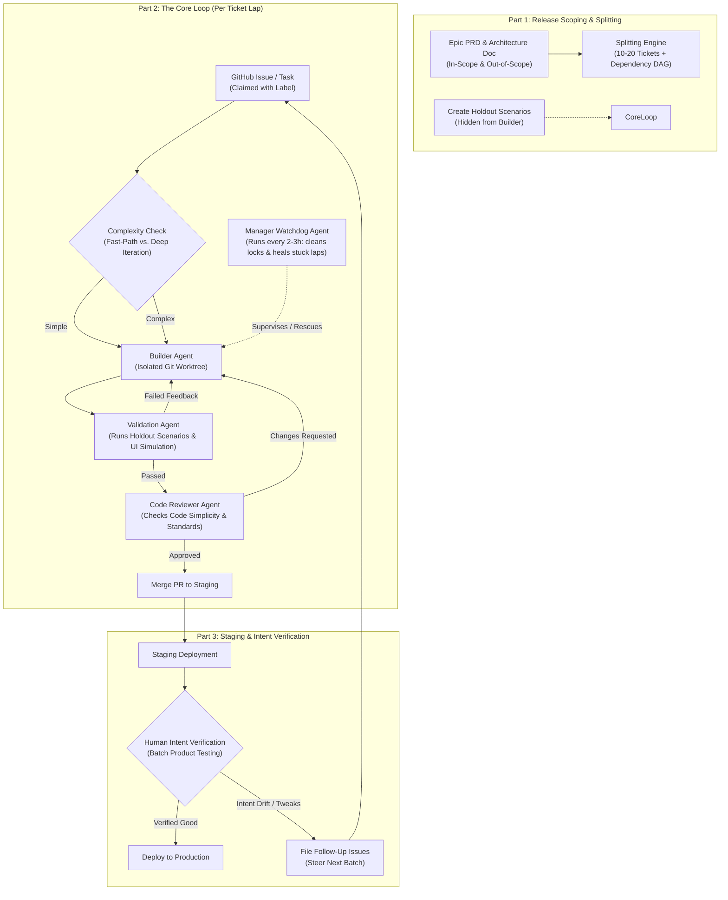

# AI Software Factory Engineering (Level 5 Agentic SDLC)

> "The bottleneck is not LLM coding capability; the bottleneck is understanding human intent and maintaining codebase sanity." — Cole Medin [03:31 - 04:44]

This skill provides an evidence-based blueprint, architectural rules, and operational checklists for building an **AI Software Factory** (Level 5 autonomous SDLC). It is distilled directly from Cole Medin's comprehensive analysis of why monolithic "Dark Factories" fail and how a disciplined, multi-stage architecture achieves continuous, dependable autonomy.

---

## 1. Why Monolithic "Dark Factories" Fail vs. Why AI Software Factories Work

### The Flaw of the Dark Factory (`Dan Shapiro Level 5`) [02:44 - 03:30]
1. **The "No Steering Wheel" Illusion**: Giving a massive PRD to an agent with instructions like *"Build this entire app from scratch, don't stop until done"* fails because humans cannot articulate 100% of their intent upfront.
2. **Intent Translation Bottleneck** [03:31 - 04:00]: Even frontier models (AGI-level) cannot read minds. As iterations increase without human grounding, errors compound exponentially.
3. **Codebase Sprawl & Decay** [04:30 - 05:00]: As noted by Dex Horthy (*"Why Software Factories Fail"*), unconstrained agents sprawl code, invent duplicate abstractions, and degrade maintainability over dozens of unsupervised commits.

### The Proven AI Software Factory Paradigm [06:30 - 07:15]
Instead of trying to generate an entire company or 10,000-line app in one unverified run, the AI Software Factory structures development into **manageable release batches (Epics)**:
- **Input**: Scoped Epic PRD + Holdout Scenarios.
- **Unit of Work**: 10 to 20 dependency-mapped GitHub/Jira tickets.
- **Core Loop**: Autonomous ticket claim → Worktree branch → Build → Validation (User Simulator) → Code Review (Simplicity & Maintainability) → PR merge to Staging.
- **Supervision**: Periodic **Manager Watchdog Agent** monitoring health and unblocking deadlocks.
- **Feedback**: Human verifies batches on **Staging** and files incremental issues to steer the factory.

---

## 2. Core Architecture Components

### Component A: Release Scoping & Splitting [09:03 - 12:10]
1. **Scope Envelope (10 to 20 Tickets)**:
   - For greenfield: Build a tight Proof of Concept (POC).
   - For brownfield: Define an Epic scoped to 10–20 atomic issues.
2. **Explicit "Out-of-Scope" Boundaries** [10:40]:
   - Define strictly what the factory **must not** build in this cycle to prevent speculative agent over-engineering.
3. **Holdout Scenarios (Anti-Sycophancy)** [10:55 - 11:40]:
   - **Crucial Rule**: The builder agent **never sees** the holdout scenarios during implementation.
   - *Why*: AI agents are sycophantic. If they know the test inputs and expected outputs upfront, they will hardcode edge cases or overfit logic just to pass the test without general robustness.
   - The holdout scenarios are quarantined in a secure test runner and only executed by the Validation Agent.
4. **Dependency Mapping & Graph Labels** [11:50]:
   - Mark issues with dependency tags (`blocked-by:#12`, `ready`, `parallel-ok`).
   - Laps run concurrently only for dependency-free leaves.

### Component B: The Core Loop & Dual-Review Gate [13:33 - 15:30]
Each ticket follows a strict isolated workflow:

1. **Claiming**:
   - Agent applies `status:in-progress` or worker ID lock to avoid race conditions across parallel worktrees.
2. **Dynamic Triage (Fast-Path vs. Iterative)** [14:00]:
   - Simple tasks (typos, CSS fixes, trivial endpoints) take the lightweight fast path (1 model pass).
   - Architectural or multi-component features use iterative build with lint/unit-test loops.
3. **Dual Separation of Quality Gates** [14:26 - 15:00]:
   - **Gate 1: App Validation (Behavioral)**: An independent agent simulates real user actions (headless browser, API payloads, CLI invocation, holdout test suite). Does the feature actually satisfy user intent?
   - **Gate 2: Code Review (Structural)**: Evaluates cleanliness, architecture compliance, security, zero dead code, and maintainability.
   - **Feedback Re-entry**: Any rejection returns actionable feedback to the Builder Agent (bounded to a strict retry budget, e.g., max 3 attempts).
4. **Protected Paths Governance** [16:40]:
   - The factory must have read-only enforcement on governance files (`engineering.md`, `mission.md`, CI/CD workflows, root permissions). Agents are strictly forbidden from altering their own constraints.

### Component C: The Manager Watchdog Agent [15:33 - 16:35]
1. **Cadence**: Runs periodically (e.g., every 1 to 3 hours).
2. **Responsibilities**:
   - Detects orphaned locks or stalled worktree sessions.
   - Identifies laps that exhausted max retries or hit circular review arguments.
   - Adjusts dependency graphs when an upstream issue closes.
   - **Escalation**: Pings the human engineer or primary second-brain agent (e.g. Claude Code / Antigravity) with a concise rescue summary when human intervention is truly needed.

### Component D: Cost & Model Tiering [15:48 - 16:35]
Do not burn frontier reasoning tokens on mundane operations:
- **Planning & Architecture**: Frontier reasoning models (Claude 3.7 Sonnet / Opus, GPT-4o / o3-mini).
- **Triage & Simple Edits**: Fast/compact models (Sonnet, GPT-4o-mini, Flash).
- **Manager Watchdog & State Polling**: Lightweight cost-efficient models.

### Component E: Staging Verification & Human Feedback [17:40 - 19:00]
1. **Never Deploy Direct to Production**:
   - The dark factory goes straight to Prod and fails. The software factory deploys the completed epic batch into **Staging**.
2. **Batch Human Verification**:
   - The human tests the product as an end-user.
   - Instead of micro-managing every line of code, the human verifies functional intent.
   - Missing behaviors or refinements are filed as 3–5 new issues that feed directly into the factory's next sprint.

---

## 3. Operational Checklists

### Phase 1: Planning & Release Scoping Checklist
- [ ] Write `PRD.md` with high-level user stories and acceptance criteria.
- [ ] Define **Explicit Out-of-Scope** list in `PRD.md`.
- [ ] Draft 3–5 **Holdout Scenarios** into a secured test manifest (`holdouts/`).
- [ ] Run ticket splitting engine to produce 10–20 atomic GitHub issues.
- [ ] Label issues with dependency order (`blocked-by:#ID`) and parallel tags.

### Phase 2: Factory Execution Harness Checklist
- [ ] Isolate each task into its own Git Worktree (`worktrees/issue-<id>`).
- [ ] Configure `Builder Agent` with access ONLY to source code and public unit tests (NO holdout scenarios).
- [ ] Configure `Validation Agent` with access to the holdout test suite and end-to-end tooling (Playwright, API client).
- [ ] Configure `Reviewer Agent` with repository style guide (`engineering.md`) and security policies.
- [ ] Set max iteration retry limit (default: 3).

### Phase 3: Watchdog & Governance Checklist
- [ ] Mark workflow files, `.env`, and `engineering.md` as protected / immutable.
- [ ] Schedule Manager Agent cron (every 60–120 minutes).
- [ ] Set up alert webhooks (Discord / Slack / IDE notification) for laps exceeding retry budget.

### Phase 4: Staging & Delivery Checklist
- [ ] Merge green PRs to `staging` branch and trigger automated staging deployment.
- [ ] Human conducts intent verification test on Staging.
- [ ] If issues found: create new GitHub issues and allow factory to run follow-up lap.
- [ ] If all requirements satisfied: promote `staging` to `main` (Production release).

---

## 4. Key Citations & Timestamps from Cole Medin's Video

| Timestamp | Topic / Insight | Key Takeaway |
| :--- | :--- | :--- |
| **[00:00 - 01:49]** | AI Dark Factory vs Software Factory | Monolithic dark factory breaks; autonomous factory works with structured scoping. |
| **[01:50 - 02:43]** | Upfront Harness Engineering | You trust the agent at runtime because you engineered the harness upfront. |
| **[02:44 - 03:30]** | Dan Shapiro 5 Autonomy Levels | Level 5 (no steering wheel) fails due to the human communication gap. |
| **[03:31 - 04:25]** | The Intent Translation Bottleneck | LLMs will never read our minds. Humans must provide the destination and course corrections. |
| **[04:30 - 05:10]** | Dex Horthy & Codebase Decay | Agents left alone sprawl code. Maintainability requires human review and clean gates. |
| **[06:30 - 07:15]** | Batching Releases vs Monolith | Give individual releases (epics) to the system, not the entire application at once. |
| **[09:03 - 10:50]** | Epic Scoping & Ticket Splitting | Break epics into 10–20 tickets; define what is NOT being built (out-of-scope). |
| **[10:55 - 11:45]** | Holdout Scenarios | Hide evaluation tests from the builder agent to prevent sycophantic overfitting. |
| **[13:33 - 14:25]** | Dynamic Triage (Fast vs Complex) | Fast path for trivial tickets; iterative loop for multi-component systems. |
| **[14:26 - 15:15]** | Dual Gate (Validation vs Review) | Validation tests the running software (user actions); Review tests code simplicity and hygiene. |
| **[15:33 - 16:35]** | Manager Watchdog Agent | Periodic supervisor that unblocks stuck PRs, aligns dependencies, and alerts humans. |
| **[16:40 - 17:05]** | Protected Paths & Rules | Never let the factory edit `mission.md` or alter its own permission boundaries. |
| **[17:06 - 17:39]** | Token & Model Optimization | Route tasks across model tiers; don't waste frontier reasoning on simple tickets. |
| **[17:40 - 19:00]** | Staging Verification Loop | Merge to Staging → human verifies in batch → file follow-up issues → deploy to Prod. |
